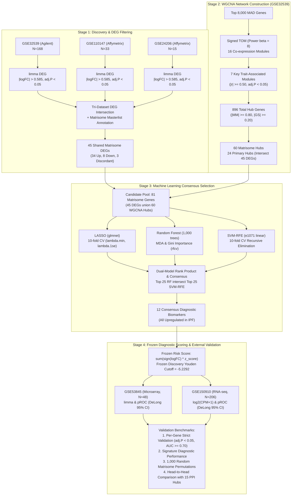
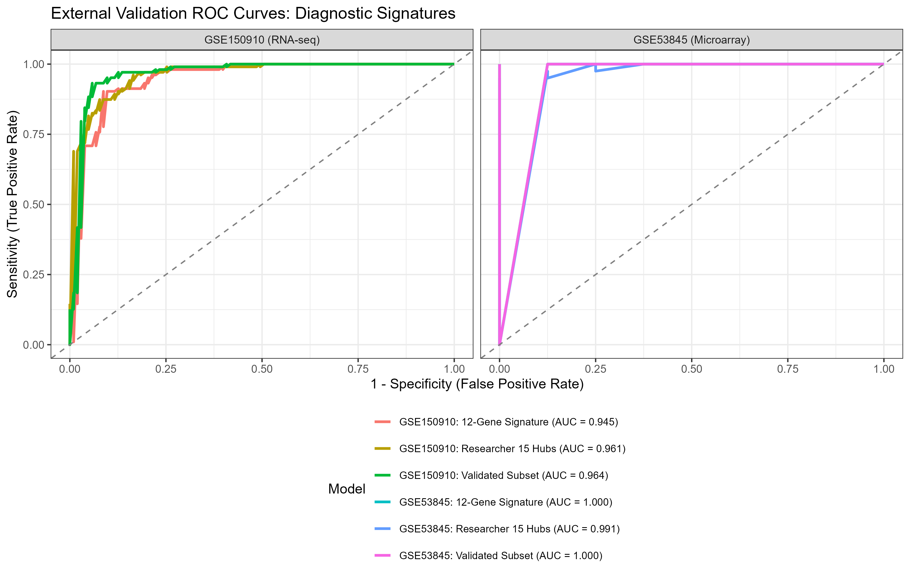
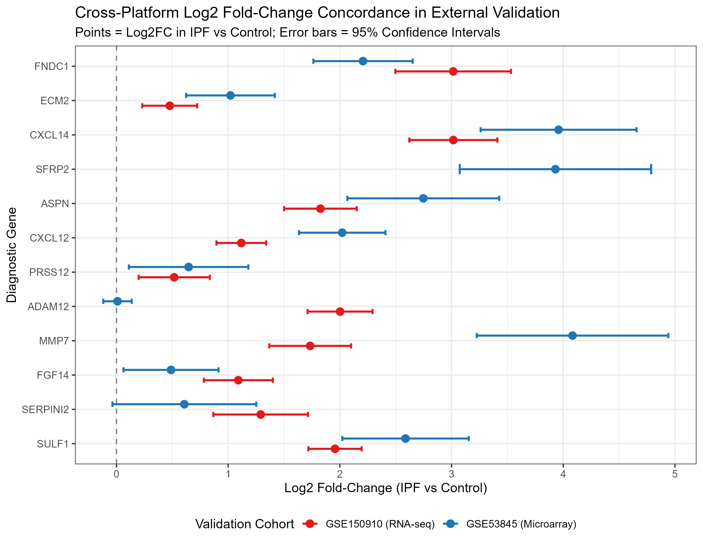
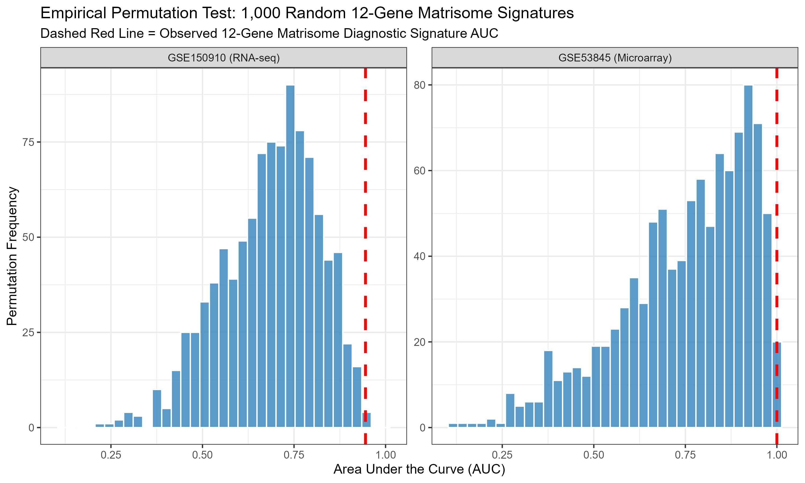
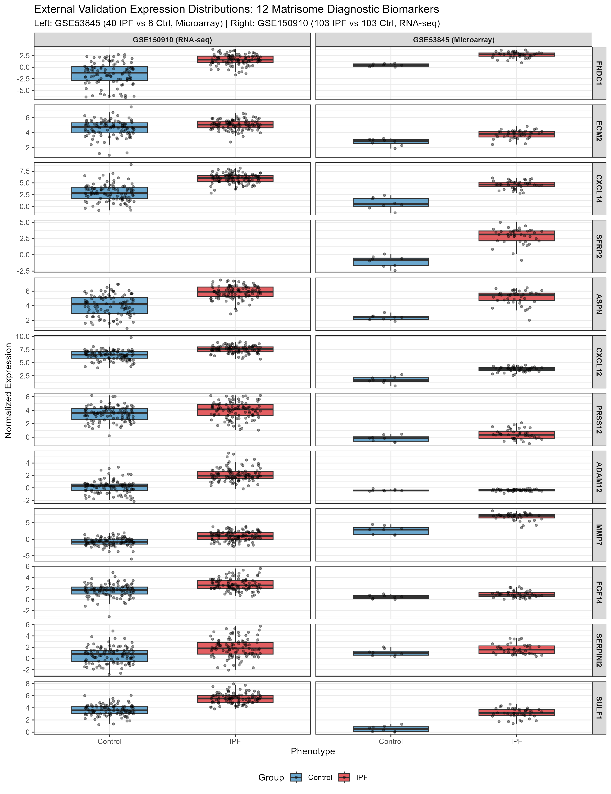

# Matrisome Hub Gene and Diagnostic Biomarker Identification in Idiopathic Pulmonary Fibrosis (IPF)

## 1. Overview

Idiopathic Pulmonary Fibrosis (IPF) is a progressive, irreversible interstitial lung disease characterized by aberrant fibroblastic proliferation, myofibroblast differentiation, and excessive extracellular matrix (ECM) deposition leading to respiratory failure. The extracellular matrix—termed the **matrisome**—plays a central role in driving fibrotic remodeling and cellular biomechanics.

The objective of this project is to systematically identify core matrisome genes that reliably distinguish IPF from normal human lung tissue. We combine multi-cohort differential expression analysis, Weighted Gene Co-expression Network Analysis (WGCNA), and three supervised machine-learning algorithms (LASSO, Random Forest, and Support Vector Machine Recursive Feature Elimination [SVM-RFE]). Identified diagnostic signatures are validated in completely held-out, independent cohorts across both microarray and high-throughput RNA-sequencing platforms. Finally, our findings are compared with a published protein-protein interaction (PPI) network-based hub gene list from a Master's thesis titled *"Identification of Matrisome Hub genes and Molecular Docking-Based Inhibitor studies in IPF"* (Thiruvalluvar University), which investigated network topology and molecular docking against ASPN.

---

## 2. Datasets

All transcriptomic profiles were obtained from NCBI Gene Expression Omnibus (GEO). Cohorts were partitioned into discovery, secondary intersection, and fully held-out external validation cohorts:

| GSE ID | Project Role | Platform | Platform Accession | Total Samples | IPF (N) | Control (N) | Tissue Origin |
| :--- | :--- | :--- | :--- | :---: | :---: | :---: | :--- |
| **GSE32539** | Discovery & Network Training | Agilent-014850 Whole Human Genome Microarray 4x44K G4112F | GPL6480 | 168 | 119 | 49 | Whole lung parenchymal tissue |
| **GSE110147** | DEG Intersection & Module Preservation | Affymetrix GeneChip Human Genome U133 Plus PM | GPL13158 | 33 | 22 | 11 | Whole lung tissue |
| **GSE24206** | DEG Intersection | Affymetrix GeneChip Human Gene 1.0 ST Array | GPL6244 | 15 | 9 | 6 | Whole lung tissue |
| **GSE53845** | External Validation Cohort 1 | Agilent-014850 Whole Human Genome Microarray 4x44K G4112F | GPL6480 | 48 | 40 | 8 | Lung tissue (Genentech / UCSF) |
| **GSE150910** | External Validation Cohort 2 | Illumina NovaSeq 6000 (RNA-seq) | GPL24676 | 206 | 103 | 103 | Whole lung tissue (Vanderbilt) |
| **GSE47460** | **EXCLUDED** | Agilent Whole Human Genome Microarray 4x44K | GPL6480 / GPL14550 | 582 | - | - | Whole lung tissue |

### Sample Selection and Independence Criteria
- **GSE32539 Sample Filtering**: Initial download contained 119 IPF and 50 control samples ($N=169$). During sample outlier quality control, sample `GSM806411` was identified as a severe outlier on hierarchical clustering and principal component analysis (PCA), and was removed prior to network construction, leaving $N=168$ (119 IPF, 49 normal control).
- **GSE150910 Sample Filtering**: Downloaded 288 lung tissue samples from Illumina NovaSeq 6000. 82 samples diagnosed with chronic hypersensitivity pneumonitis (CHP) were excluded to maintain an unambiguous IPF vs Normal Control comparison, resulting in $N=206$ (103 IPF, 103 Control).
- **Exclusion of GSE47460**: Donor metadata inspection revealed patient identifiers such as `LT001098RU`, confirming patient sample accrual through the NHLBI Lung Tissue Research Consortium (LTRC). Because discovery cohort GSE32539 was also derived from LTRC, including GSE47460 would introduce severe donor pseudo-replication and data leakage. GSE47460 was therefore strictly excluded.
- **Exposure Audit**: Cohorts GSE32539, GSE110147, and GSE24206 were utilized upstream during differential expression and 3-dataset DEG intersection. Consequently, GSE110147 and GSE24206 are partially exposed to gene selection. In contrast, **GSE53845 and GSE150910 were completely held out and unexposed** during all phases of feature selection, model training, and threshold selection.

---

## 3. Methods and Pipeline

The project workflow proceeds through sequential stages of transcriptomic harmonization, co-expression network analysis, machine learning feature selection, frozen signature deployment, and external validation:



### Analytical Steps
1. **Differential Expression Analysis**: Microarray probes were mapped to official NCBI gene symbols (collapsing multi-probe genes by maximum median expression). Linear modeling via `limma` identified DEGs with $|\log_2\text{FC}| > 0.585$ ($\text{fold change} > 1.5$) and Benjamini-Hochberg adjusted $P < 0.05$. Cross-referencing against the Human Matrisome Masterlist (1,027 in silico validated genes) identified **45 shared matrisome DEGs** across all three discovery datasets.
2. **Weighted Gene Co-expression Network Analysis (WGCNA)**: Executed on GSE32539 using the top 8,000 genes ranked by Median Absolute Deviation (MAD). All 45 shared DEGs were retained. A signed topological overlap matrix (TOM) was constructed using soft-thresholding power $\beta = 8$ (scale-free topology fit $R^2 > 0.85$). 16 modules were detected. Modules exhibiting $|r| \ge 0.50$ and FDR adjusted $P < 0.05$ with clinical trait (IPF vs Control) were defined as key modules. Hub genes were strictly defined by module membership $|MM| \ge 0.80$ and gene significance $|GS| \ge 0.20$.
3. **Machine Learning Feature Selection**: Evaluated across candidate matrisome genes encompassing the union of the 45 shared DEGs and the 60 WGCNA matrisome hubs:
   - **LASSO** (`glmnet`): Binomial penalized logistic regression with 10-fold cross-validation, recording features at $\lambda_{\text{min}}$ and $\lambda_{\text{1se}}$.
   - **Random Forest** (`randomForest`): 1,000 classification trees; variable importance quantified by Mean Decrease in Accuracy (MDA) and Mean Decrease in Gini impurity; 10-fold cross-validation (`rfcv`).
   - **SVM-RFE** (`e1071`): Linear kernel Support Vector Machine backward elimination with 10-fold cross-validation.
   - **Consensus Selection**: Computed geometric rank product of RF (MDA) and SVM-RFE ranks. Intersecting the top 25 features of both models yielded **12 consensus diagnostic biomarker genes**, confirmed with LASSO.
4. **Frozen Diagnostic Risk Model**:
   $$\text{Risk Score} = \sum_{g \in \text{Signature}} \text{sign}(\log_2\text{FC}_g) \cdot z_g$$
   where $z_g$ is z-score standardized strictly within each cohort. The optimal Youden classification threshold was determined strictly on discovery cohort GSE32539 ($\text{threshold} = -5.2292$) and frozen.
5. **External Validation Standards**: Evaluated on completely unexposed datasets GSE53845 and GSE150910:
   - `VALIDATED`: Concordant direction (UP) + FDR adjusted $P < 0.05$ + single-gene $AUC \ge 0.70$.
   - `DIRECTION-ONLY`: Concordant direction (UP) + fails adjusted $P < 0.05$ or $AUC < 0.70$.
   - `NOT VALIDATED`: Discordant direction or missing from platform.
6. **Permutation Control**: Evaluated 1,000 randomly sampled 12-gene sets from the Matrisome Masterlist to calculate empirical p-values.
7. **Comparison with Thesis PPI Hubs**: Direct comparison against the 15 PPI hub genes derived from STRING and CytoHubba in the Thiruvalluvar University thesis.

---

## 4. Results

### 4.1 The 12 Consensus Diagnostic Biomarkers

The dual machine-learning consensus intersection identified 12 diagnostic genes. All 12 genes belong to key WGCNA modules and are consistently upregulated in IPF:

| Gene Symbol | Matrisome Division | Matrisome Category | WGCNA Module | RF Rank (MDA) | SVM-RFE Rank | Geometric Rank Product | Discovery Mean AUC | Discovery Direction | LASSO Selected ($\lambda_{\text{min}}$) |
| :--- | :--- | :--- | :--- | :---: | :---: | :---: | :---: | :---: | :---: |
| **`FNDC1`** | Core matrisome | ECM Glycoproteins | Green (Mod 5) | 1 | 1 | 1.00 | 0.9104 | UP | Yes |
| **`ECM2`** | Core matrisome | ECM Glycoproteins | Green (Mod 5) | 15 | 2 | 5.48 | 0.9374 | UP | Yes |
| **`CXCL14`** | Matrisome-associated | Secreted Factors | Green (Mod 5) | 8 | 4 | 5.66 | 0.9430 | UP | Yes |
| **`SFRP2`** | Matrisome-associated | ECM Regulators | Green (Mod 5) | 3 | 13 | 6.24 | 0.8824 | UP | Yes |
| **`ASPN`** | Core matrisome | Proteoglycans | Green (Mod 5) | 2 | 24 | 6.93 | 0.9861 | UP | Yes |
| **`CXCL12`** | Matrisome-associated | Secreted Factors | Green (Mod 5) | 7 | 17 | 10.91 | 0.8699 | UP | Yes |
| **`PRSS12`** | Matrisome-associated | ECM Regulators | Turquoise (Mod 1) | 17 | 8 | 11.66 | 0.9244 | UP | Yes |
| **`ADAM12`** | Matrisome-associated | ECM Regulators | Green (Mod 5) | 9 | 20 | 13.42 | 0.9606 | UP | Yes |
| **`MMP7`** | Matrisome-associated | ECM Regulators | Turquoise (Mod 1) | 18 | 11 | 14.07 | 0.9652 | UP | Yes |
| **`FGF14`** | Matrisome-associated | Secreted Factors | Turquoise (Mod 1) | 21 | 18 | 19.44 | 0.9039 | UP | No |
| **`SERPINI2`**| Matrisome-associated | ECM Regulators | Turquoise (Mod 1) | 20 | 22 | 20.98 | 0.9480 | UP | No |
| **`SULF1`** | Matrisome-associated | ECM Regulators | Green (Mod 5) | 22 | 23 | 22.49 | 0.9441 | UP | No |

---

### 4.2 Discovery and Early Cohort Performance

When evaluated across the three discovery/intersection cohorts using the composite risk score:

| Cohort | Platform | N Samples | AUC | 95% DeLong CI | Sensitivity | Specificity | Accuracy | PPV | NPV |
| :--- | :--- | :---: | :---: | :---: | :---: | :---: | :---: | :---: | :---: |
| **GSE32539** (Discovery) | Agilent GPL6480 | 168 | 0.999 | 0.997–1.000 | 98.3% | 100.0% | 98.8% | 100.0% | 96.1% |
| **GSE110147** (Secondary) | Affymetrix GPL13158 | 33 | 1.000 | 1.000–1.000 | 100.0% | 100.0% | 100.0% | 100.0% | 100.0% |
| **GSE24206** (Secondary) | Affymetrix GPL6244 | 15 | 1.000 | 1.000–1.000 | 100.0% | 100.0% | 100.0% | 100.0% | 100.0% |

> **Critical Caveat**: The AUC of 1.000 observed in GSE110147 and GSE24206 does **NOT** constitute independent validation. These cohorts were included in the 3-dataset limma intersection that selected the candidate DEGs. While demonstrating internal consistency, true generalization must be judged on independent cohorts unexposed to feature selection.

---

### 4.3 External Validation Per Gene

Single-gene differential expression and ROC AUC were evaluated in completely held-out cohorts GSE53845 ($N=48$, microarray) and GSE150910 ($N=206$, RNA-seq):

| Gene Symbol | Expected Direction | GSE53845 Log2FC | GSE53845 Adj.P | GSE53845 AUC (95% CI) | GSE53845 Status | GSE150910 Log2FC | GSE150910 Adj.P | GSE150910 AUC (95% CI) | GSE150910 Status | Overall Verdict |
| :--- | :---: | :---: | :---: | :---: | :---: | :---: | :---: | :---: | :---: | :---: |
| **`SULF1`** | UP | +2.588 | $9.8 \times 10^{-10}$ | 1.000 (1.00–1.00) | **VALIDATED** | +1.957 | $1.1 \times 10^{-35}$ | 0.949 (0.92–0.98) | **VALIDATED** | **CORE VALIDATED (2/2)** |
| **`CXCL14`** | UP | +3.958 | $3.6 \times 10^{-12}$ | 1.000 (1.00–1.00) | **VALIDATED** | +3.016 | $1.1 \times 10^{-32}$ | 0.931 (0.89–0.97) | **VALIDATED** | **CORE VALIDATED (2/2)** |
| **`FNDC1`** | UP | +2.207 | $1.2 \times 10^{-10}$ | 1.000 (1.00–1.00) | **VALIDATED** | +3.015 | $3.5 \times 10^{-22}$ | 0.870 (0.82–0.92) | **VALIDATED** | **CORE VALIDATED (2/2)** |
| **`ASPN`** | UP | +2.747 | $1.7 \times 10^{-8}$ | 0.978 (0.93–1.00) | **VALIDATED** | +1.826 | $4.8 \times 10^{-21}$ | 0.859 (0.81–0.91) | **VALIDATED** | **CORE VALIDATED (2/2)** |
| **`CXCL12`** | UP | +2.021 | $3.5 \times 10^{-11}$ | 0.997 (0.99–1.00) | **VALIDATED** | +1.118 | $1.1 \times 10^{-17}$ | 0.848 (0.80–0.90) | **VALIDATED** | **CORE VALIDATED (2/2)** |
| **`MMP7`** | UP | +4.083 | $3.5 \times 10^{-10}$ | 0.984 (0.96–1.00) | **VALIDATED** | +1.734 | $4.1 \times 10^{-16}$ | 0.816 (0.76–0.87) | **VALIDATED** | **CORE VALIDATED (2/2)** |
| **`ADAM12`** | UP | +0.010 | 0.937 | 0.528 (0.30–0.75) | DIRECTION-ONLY | +2.002 | $2.5 \times 10^{-28}$ | 0.925 (0.89–0.96) | **VALIDATED** | Validated in RNA-seq (Probe failure in Agilent) |
| **`SFRP2`** | UP | +3.930 | $9.1 \times 10^{-10}$ | 0.988 (0.96–1.00) | **VALIDATED** | *NA* | *NA* | *NA* | *Missing (Annotation)* | Validated in Microarray |
| **`FGF14`** | UP | +0.489 | 0.087 | 0.763 (0.59–0.93) | DIRECTION-ONLY | +1.091 | $3.9 \times 10^{-10}$ | 0.753 (0.69–0.82) | **VALIDATED** | Validated in RNA-seq |
| **`SERPINI2`**| UP | +0.608 | 0.172 | 0.713 (0.52–0.91) | DIRECTION-ONLY | +1.291 | $5.5 \times 10^{-8}$ | 0.723 (0.65–0.79) | **VALIDATED** | Validated in RNA-seq |
| **`ECM2`** | UP | +1.021 | $9.0 \times 10^{-5}$ | 0.941 (0.88–1.00) | **VALIDATED** | +0.477 | $5.4 \times 10^{-4}$ | 0.637 (0.56–0.71) | DIRECTION-ONLY | Validated in Microarray |
| **`PRSS12`** | UP | +0.646 | 0.070 | 0.750 (0.58–0.92) | DIRECTION-ONLY | +0.517 | $4.0 \times 10^{-3}$ | 0.629 (0.55–0.71) | DIRECTION-ONLY | Direction-Only in both |

### Key Observations
- **Core Invariant Replicated Set (6 genes)**: `SULF1`, `CXCL14`, `FNDC1`, `ASPN`, `CXCL12`, and `MMP7` strictly passed in both independent microarray and RNA-seq cohorts ($AUC \ge 0.816$ to $1.000$).
- **Microarray-Specific Validation (2 genes)**: `SFRP2` validated strongly in GSE53845 ($AUC = 0.988$), but was unannotated in the GSE150910 RNA-seq count matrix. `ECM2` validated in GSE53845 ($AUC = 0.941$), but yielded an AUC of 0.637 in GSE150910.
- **RNA-seq-Specific Validation (3 genes)**: `ADAM12` ($AUC = 0.925$), `FGF14` ($AUC = 0.753$), and `SERPINI2` ($AUC = 0.723$) validated strictly in GSE150910. In GSE53845, `ADAM12` probe intensity showed no dynamic range ($AUC = 0.528$), while `FGF14` and `SERPINI2` were DIRECTION-ONLY ($AUC > 0.71$, but adj.P > 0.05).
- **Sub-threshold (1 gene)**: `PRSS12` was consistently upregulated in both cohorts ($+0.65$ and $+0.52 \log_2\text{FC}$), but failed strict cutoff (GSE53845 adj.P = 0.070; GSE150910 AUC = 0.629).
- **Summary**: **11 of 12 genes strictly validated in at least one independent cohort**, with **zero direction reversals**.

---

### 4.4 Signature-Level Diagnostic Performance in Held-Out Cohorts

The composite risk score was evaluated in the held-out cohorts using the frozen Youden threshold from discovery ($\text{cutoff} = -5.2292$ for the 12-gene model; proportional cutoffs for subsets):

| Cohort | Model / Feature Subset | Evaluated Genes | Frozen Discovery Cutoff | AUC | 95% DeLong CI | Sensitivity | Specificity | Accuracy | PPV | NPV |
| :--- | :--- | :---: | :---: | :---: | :---: | :---: | :---: | :---: | :---: | :---: |
| **GSE53845** (Microarray) | **Full 12-Gene Signature** | 12 | -5.2292 | **1.0000** | 1.0000–1.0000 | 92.5% | 100.0% | **93.8%** | 100.0% | 72.7% |
| GSE53845 (Microarray) | Validated Subset ($n=8$) | 8 | -2.3118 | **1.0000** | 1.0000–1.0000 | 92.5% | 100.0% | **93.8%** | 100.0% | 72.7% |
| GSE53845 (Microarray) | Core Replicated Subset ($n=6$) | 6 | -1.8556 | **1.0000** | 1.0000–1.0000 | 92.5% | 100.0% | **93.8%** | 100.0% | 72.7% |
| **GSE150910** (RNA-seq) | **Full Signature** (11 present) | 11 | -5.2292 | **0.9452** | 0.9129–0.9776 | 100.0% | 49.5% | **74.8%** | 66.5% | 100.0% |
| GSE150910 (RNA-seq) | Validated Subset ($n=9$) | 9 | -3.7383 | **0.9643** | 0.9370–0.9915 | 99.0% | 60.2% | **79.6%** | 71.3% | 98.4% |
| GSE150910 (RNA-seq) | **Core Replicated Subset** ($n=6$) | 6 | -1.8556 | **0.9614** | 0.9334–0.9893 | 98.1% | 67.0% | **82.5%** | 74.8% | 97.2% |

In GSE53845, the signature achieved complete separation ($AUC = 1.0000$). In GSE150910, the frozen full signature achieved an $AUC = 0.9452$, which rose to **$AUC = 0.9614$ (82.5% accuracy)** when restricted to the Core 6-Gene Invariant Subset.

---

### 4.5 Permutation Null Test

To verify that the high diagnostic AUC is not merely an artifact of generic lung fibrosis ECM upregulation, 1,000 random sets of 12 matrisome genes were drawn from the Matrisome Masterlist and tested under identical scoring conditions:

| Cohort | True Signature AUC | Null Mean AUC | Null SD | 95th Percentile Null AUC | Empirical $P$-value |
| :--- | :---: | :---: | :---: | :---: | :---: |
| **GSE53845** (Microarray) | **1.0000** | 0.7515 | 0.1787 | 0.9719 | **$P = 0.003996$ ($\approx 0.004$)** |
| **GSE150910** (RNA-seq) | **0.9452** | 0.6851 | 0.1320 | 0.8772 | **$P = 0.002997$ ($\approx 0.003$)** |

The empirical p-values ($P < 0.005$) confirm that the 12-gene signature possesses discrimination significantly exceeding that of arbitrary ECM constituents.

---

### 4.6 Comparison with Researcher's 15 PPI Hub Genes

We performed a direct head-to-head evaluation against the 15 PPI hub genes identified in the Master's thesis (*Thiruvalluvar University*): `ASPN`, `COL14A1`, `COL15A1`, `COL1A1`, `COL3A1`, `COL5A2`, `COMP`, `IL6`, `MMP10`, `MMP7`, `MMP8`, `OGN`, `SFRP4`, `TGFB3`, `TIMP3`.

#### Individual Gene Replication of Researcher's 15 Hubs
- **GSE53845 Microarray**: 13 of 15 genes were strictly VALIDATED (`ASPN`, `COL14A1`, `COL15A1`, `COL1A1`, `COL3A1`, `COL5A2`, `COMP`, `MMP10`, `MMP7`, `OGN`, `SFRP4`, `TGFB3`, `TIMP3`).
- **GSE150910 RNA-seq**: 12 of 14 present genes were strictly VALIDATED (`ASPN`, `COL14A1`, `COL15A1`, `COL1A1`, `COL3A1`, `COL5A2`, `COMP`, `MMP7`, `OGN`, `SFRP4`, `TGFB3`, `TIMP3`; `MMP10` was missing from annotation).
- **Failing Genes in Researcher's List**:
  - **`IL6`**: Failed completely in both cohorts. Expected DOWN, but showed non-significant positive drift (GSE53845: $\log_2\text{FC} = +1.18$, adj.P = 0.217, $AUC = 0.3188$; GSE150910: $\log_2\text{FC} = +0.13$, adj.P = 0.753, $AUC = 0.4692$).
  - **`MMP8`**: DIRECTION-ONLY in both cohorts; failed both significance and AUC thresholds (GSE53845: $AUC = 0.5000$, adj.P = 0.9166; GSE150910: $AUC = 0.5224$, adj.P = 0.2583).

#### Signature-Level Comparison

| Evaluation Metric | Our 12-Gene ML Matrisome Signature | Researcher's 15 PPI Hub Signature |
| :--- | :---: | :---: |
| **Underlying Methodology** | WGCNA Turquoise/Green Modules + Triple-ML (LASSO + RF + SVM-RFE) | StringDB PPI Degree/Betweenness on 45 DEGs (CytoHubba) |
| **GSE53845 AUC** | **1.0000** (95% CI: 1.0000–1.0000) | **0.9906** (95% CI: 0.9719–1.0000) |
| **GSE53845 Accuracy** | **93.8%** | **91.7%** |
| **GSE150910 AUC** | **0.9452** (Core 6-Gene: **0.9614**) | **0.9614** (95% CI: 0.9371–0.9856) |
| **GSE150910 Accuracy** | **74.8%** (Core 6-Gene: **82.5%**) | **83.5%** |
| **Collinear Redundancy** | Low (Spans proteoglycans, remodeling enzymes, and chemokines) | High (Contains 5 structural collagens: COL1A1, COL3A1, COL5A2, COL14A1, COL15A1) |

#### Overlap Analysis and Methodological Differences
- **Overlap with 12 ML Genes**: Only **`ASPN`** and **`MMP7`** overlap between our 12-gene ML signature and the researcher's 15 PPI hubs. Both genes are in our Core Replicated 6-gene set. The thesis chose **`ASPN`** as its molecular docking target, confirming its central functional importance.
- **Overlap with our 24 Primary WGCNA Hubs**: Our 24 primary hubs (`MUC5B`, `PRSS12`, `ASPN`, `CLEC4E`, `MUC4`, `SFRP2`, `S100A8`, `COL14A1`, `FGF14`, `SULF1`, `CRISPLD1`, `COL15A1`, `SERPINI2`, `S100A12`, `OGN`, `MMP16`, `MUC16`, `ECM2`, `COL1A2`, `MATN3`, `SERPINB5`, `HMCN1`, `LTBP1`, `CCBE1`) overlap with the researcher's 15 hubs at 4 genes: **`ASPN`**, **`COL14A1`**, **`COL15A1`**, and **`OGN`**.
- **Why the Lists Differ**: The researcher ranked genes solely by PPI topology (degrees and betweenness in STRING). In contrast, WGCNA identifies co-expression modules linked to disease traits, and machine learning explicitly optimizes classification margin and feature redundancy. Furthermore, our candidate pool was broader (81 genes): genes like **`FNDC1`** and **`CXCL12`** were selected by WGCNA co-expression even though they were not part of the initial 45 DEG intersection.

---

### 4.7 Final Take-Home Message

1. **ASPN and MMP7** represent the highest-confidence biomarkers supported by every method: multi-cohort DEG analysis, WGCNA hub status, LASSO selection, Random Forest importance, SVM-RFE ranking, independent external validation ($AUC > 0.81$–$0.98$), and external PPI network topology.
2. **SULF1, CXCL14, FNDC1, and CXCL12** represent novel, robustly validated matrisome diagnostic markers identified through co-expression and machine learning that were missed by standard PPI degree ranking.

---

## 5. Limitations

1. **Small Control Group in GSE53845**: GSE53845 contains 40 IPF patients but only 8 normal controls. While discrimination was complete ($AUC = 1.000$), parametric DeLong confidence intervals degenerate to 1.000–1.000; non-parametric bootstrap resampling provides more realistic dispersion estimates.
2. **Cross-Platform Cutoff Portability**: The frozen Youden classification threshold ($-5.2292$) calibrated on discovery microarray GSE32539 yielded high specificity (100.0%) in microarray GSE53845, but lower specificity (49.5%) in RNA-seq GSE150910 due to platform scale differences. Cross-platform diagnostic scoring should rely on rank-based metrics (AUC) or platform-specific recalibration.
3. **Technical Probe / Annotation Discrepancies**:
   - `ADAM12` failed in GSE53845 ($AUC = 0.528$) due to poor hybridization dynamic range on Agilent probe `A_23_P123512`, yet showed strong differential expression in RNA-seq ($AUC = 0.925$).
   - `SFRP2` was unannotated in the GSE150910 count matrix, preventing evaluation in RNA-seq despite excellent performance in microarrays ($AUC = 0.988$).
4. **Tissue-Level Resolution**: All transcriptomic data originate from bulk whole-lung parenchyma, obscuring cell-type-specific contributions (e.g., alveolar type II epithelial cells vs invasive myofibroblasts).
5. **No Wet-Lab Experimental Validation**: Protein-level validation (e.g., ELISA, Western blot, IHC) in prospective human serum or lung biopsies was outside the scope of this in silico study.
6. **Prior Exposure of Secondary Cohorts**: The perfect AUCs (1.000) reported in GSE110147 and GSE24206 reflect upstream involvement in DEG filtering rather than pure external validation.

---

## 6. Repository Structure

```
d:/2ND PROJECT/project/
├── .gitignore
├── README.md
├── README_matrisome.md
├── README_prespecified.md
├── README_wgcna.md
├── requirements.txt
├── run_all.sh
├── scripts/
│   ├── 01_download_geo.R             # Downloads discovery & secondary cohorts from GEO
│   ├── 01_download_geo_fallback.py   # Python fallback for direct GEO matrix retrieval
│   ├── 02_deg_limma.R                # Runs limma DEG analysis on GSE32539, GSE110147, GSE24206
│   ├── 03_matrisome_filter.py        # Filters DEGs against Matrisome Masterlist
│   ├── 04_deg_volcano_heatmap.R      # Generates volcano plots and expression heatmaps
│   ├── 05_common_degs.py             # Computes 3-way Venn overlap of matrisome DEGs
│   ├── 05_matrisome_annotate.R       # MatrisomeAnalyzeR annotation of 45 shared DEGs
│   ├── 06_wgcna.R                    # WGCNA co-expression network analysis on GSE32539
│   ├── 07_machine_learning.R         # Machine learning (RF, SVM-RFE, consensus 12 biomarkers)
│   ├── 08_prespecified_wgcna.R       # Hypothesis testing of researcher's 15 PPI hubs in WGCNA
│   ├── 09_prespecified_auc.R         # Single-gene diagnostic AUCs for researcher's 15 genes
│   ├── 10_prespecified_classifier.R  # Multi-gene classifier evaluation of researcher's 15 genes
│   ├── 11_prespecified_final_table.R # Final summary compilation for researcher's 15 genes
│   ├── 13_external_validation.R      # External validation in GSE53845 & GSE150910 cohorts
│   └── build_gene_level_expr.R       # Helper script for collapsing multi-probe matrices
├── results/
│   ├── figures/
│   │   ├── deg/                      # Volcano and heatmap figures
│   │   ├── wgcna/                    # Dendrograms, module-trait heatmaps, TOM plots
│   │   ├── ml/                       # Machine learning ROC curves and feature importance
│   │   ├── prespecified/             # Pre-specified thesis comparison figures
│   │   └── validation/               # External validation figures (ROC, forest, permutation)
│   ├── tables/
│   │   ├── deg/                      # limma DEG output tables
│   │   ├── wgcna/                    # Module assignments, MM, GS, hub gene lists
│   │   ├── ml/                       # Biomarker tables, RF importance, SVM rankings
│   │   ├── prespecified/             # Pre-specified test results
│   │   └── validation/               # Validation results, frozen signature, permutation
│   ├── ML_DIAGNOSTIC_SUMMARY.md      # Summary of machine learning biomarker discovery
│   └── VALIDATION_SUMMARY.md         # Comprehensive report of external validation results
└── archive/                          # Archived temporary inspection, test, and check scripts
```

---

## 7. How to Reproduce

### Computational Environment
- **R Version**: R version 4.6.2 (Windows ucrt)
- **Random Seed**: `20261102` (fixed across all stochastic operations)

### Required R Packages
Install core CRAN and Bioconductor packages:
```r
install.packages(c("ggplot2", "pheatmap", "WGCNA", "patchwork", "igraph", 
                   "randomForest", "e1071", "pROC", "glmnet", "data.table"))

if (!requireNamespace("BiocManager", quietly = TRUE))
    install.packages("BiocManager")

BiocManager::install(c("GEOquery", "limma", "EnhancedVolcano", 
                       "org.Hs.eg.db", "clusterProfiler", "edgeR", 
                       "impute", "preprocessCore", "GO.db", "AnnotationDbi"))

# Matrisome annotation package
# devtools::install_github("Matrisome/MatrisomeAnalyzeR")
```

### Required Python Packages
```bash
pip install pandas requests matplotlib matplotlib-venn
```

### Execution Order
Scripts are executed sequentially from the project root:
```bash
# 1. Ingestion and Differential Expression
Rscript scripts/01_download_geo.R
Rscript scripts/02_deg_limma.R
python scripts/03_matrisome_filter.py
Rscript scripts/04_deg_volcano_heatmap.R
python scripts/05_common_degs.py
Rscript scripts/05_matrisome_annotate.R

# 2. Gene-level matrix generation and WGCNA
Rscript scripts/build_gene_level_expr.R
Rscript scripts/06_wgcna.R

# 3. Machine Learning Biomarker Discovery
Rscript scripts/07_machine_learning.R

# 4. Evaluation of Researcher's 15 PPI Hubs
Rscript scripts/08_prespecified_wgcna.R
Rscript scripts/09_prespecified_auc.R
Rscript scripts/10_prespecified_classifier.R
Rscript scripts/11_prespecified_final_table.R

# 5. Independent External Validation
Rscript scripts/13_external_validation.R
```

**Expected Runtime**: Approximately 45–60 minutes on an 8-core CPU (WGCNA blockwise TOM calculation and 1,000 permutation runs account for ~30 minutes).

---

## 8. Output Files and Key Figures

### Key Tables
- `results/tables/wgcna/hub_genes_final.csv`: Comprehensive list of all 896 WGCNA hubs with connectivity metrics.
- `results/tables/wgcna/hubs_primary.csv`: 24 primary hubs intersecting the 45 shared matrisome DEGs.
- `results/tables/ml/diagnostic_biomarkers.csv`: The 12 consensus biomarkers with RF and SVM-RFE rankings.
- `results/tables/validation/signature_locked.csv`: Locked frozen reference of the 12 signature genes and scoring directions.
- `results/tables/validation/validation_gene_results.csv`: Per-gene differential expression, 95% CIs, and single-gene AUCs in external cohorts.
- `results/tables/validation/validation_signature_performance.csv`: Diagnostic metrics (AUC, sensitivity, specificity, accuracy) across all models.
- `results/tables/validation/random_permutation_matrisome_12genes.csv`: 1,000-iteration permutation test statistics and empirical p-values.
- `results/tables/validation/researcher_hubs_validation.csv`: Validation benchmarks for the researcher's 15 PPI hub genes.

### Key Validation Figures

#### 1. Diagnostic ROC Curves Across Validation Cohorts


#### 2. Forest Plot of Effect Sizes Across Cohorts


#### 3. Permutation Null Test Distribution (1,000 Iterations)


#### 4. Expression Boxplots of 12 Diagnostic Biomarkers


---

## 9. Data Availability

Raw microarray and RNA-sequencing data used in this study are publicly available in the NCBI GEO repository:
- **GSE32539**: [https://www.ncbi.nlm.nih.gov/geo/query/acc.cgi?acc=GSE32539](https://www.ncbi.nlm.nih.gov/geo/query/acc.cgi?acc=GSE32539)
- **GSE110147**: [https://www.ncbi.nlm.nih.gov/geo/query/acc.cgi?acc=GSE110147](https://www.ncbi.nlm.nih.gov/geo/query/acc.cgi?acc=GSE110147)
- **GSE24206**: [https://www.ncbi.nlm.nih.gov/geo/query/acc.cgi?acc=GSE24206](https://www.ncbi.nlm.nih.gov/geo/query/acc.cgi?acc=GSE24206)
- **GSE53845**: [https://www.ncbi.nlm.nih.gov/geo/query/acc.cgi?acc=GSE53845](https://www.ncbi.nlm.nih.gov/geo/query/acc.cgi?acc=GSE53845)
- **GSE150910**: [https://www.ncbi.nlm.nih.gov/geo/query/acc.cgi?acc=GSE150910](https://www.ncbi.nlm.nih.gov/geo/query/acc.cgi?acc=GSE150910)

Raw data files and large processed matrices are not tracked in this repository to comply with storage recommendations. Executing `scripts/01_download_geo.R` and `scripts/13_external_validation.R` downloads and reconstructs the data directly into `data/raw/` and `data/processed/`.

---

## 10. Citation and Acknowledgements

- **Comparison Source**: Comparative PPI hub genes and docking rationale were sourced from the Master's thesis: *"Identification of Matrisome Hub genes and Molecular Docking-Based Inhibitor studies in IPF"*, Department of Biotechnology, Thiruvalluvar University.
- **Matrisome Masterlist**: Sourced from the Matrisome Project (Naba et al., *Molecular & Cellular Proteomics*, 2012; [http://matrisomeproject.mit.edu/](http://matrisomeproject.mit.edu/)).
- **Author**: [Author Name Placeholder - to be updated]
- **Affiliation**: [Institutional Affiliation Placeholder - to be updated]
- **License**: [License Placeholder, e.g., MIT License / CC BY 4.0 - to be confirmed by user]
